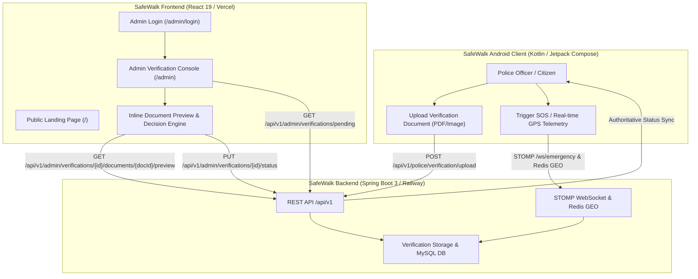

# SafeWalk Frontend

The official web portal and administrative verification console for the **SafeWalk** emergency safety and proximity dispatch ecosystem.

SafeWalk coordinates rapid emergency assistance by connecting citizens in distress with nearby verified responders—including police officers, campus safety personnel, and verified volunteers—within an adaptive ~2 km response radius.

The **SafeWalk Frontend** serves two distinct functions within the ecosystem:
1. **Public Product & Platform Portal (`/`)** — An interactive, human-centered web experience that communicates SafeWalk's core mission, the 4-stage emergency response lifecycle, proximity search architecture, and responder verification standards.
2. **Authoritative Admin Governance Console (`/admin`)** — A secure, role-restricted dashboard for administrators to review incoming police and institutional credentials, securely inspect uploaded document PDFs inline, issue authoritative approvals or rejections, and monitor registered user accounts.

---

## 🔗 Project Links

| Destination | Link | Description |
| :--- | :--- | :--- |
| **Live Frontend** | [safewalk-frontend-beta.vercel.app](https://safewalk-frontend-beta.vercel.app/) | Verified live production deployment on Vercel |
| **Frontend Repository** | [github.com/gauravto312-wq/safewalk-frontend](https://github.com/gauravto312-wq/safewalk-frontend) | React 19 + Vite 8 source code and build assets |
| **Backend Repository** | [github.com/gauravto312-wq/safewalk-backend](https://github.com/gauravto312-wq/safewalk-backend) | Spring Boot 3, MySQL, Redis GEO, Kafka, & STOMP backend |
| **Deployed Backend** | [safewalk-backend-production-e3a1.up.railway.app](https://safewalk-backend-production-e3a1.up.railway.app/) | Live production API base deployed on Railway |
| **Android Repository** | [github.com/gauravto312-wq/SafeWalk-Android](https://github.com/gauravto312-wq/SafeWalk-Android) | Native Android mobile application in Kotlin & Jetpack Compose |
| **Android Release v1.0.0** | [SafeWalk Release v1.0.0](https://github.com/gauravto312-wq/SafeWalk-Android/releases/tag/v1.0.0) | Official GitHub release tag and distribution notes |
| **Direct Android APK** | [SafeWalk-v1.0.0.apk](https://github.com/gauravto312-wq/SafeWalk-Android/releases/download/v1.0.0/SafeWalk-v1.0.0.apk) | Direct APK download for Android devices |
| **SafeWalk Demo Video** | [youtu.be/91b0QSqxUSY](https://youtu.be/91b0QSqxUSY) | Full end-to-end product demonstration video on YouTube |

> **Deployment Note:** The live frontend deployment was verified reachable via HTTP `200 OK` on Vercel.

---

## ✨ Features

The web frontend codebase was thoroughly audited to verify implemented functionality versus capabilities managed by the companion Android app and Spring Boot backend:

### Verified Frontend Implementation

- **Public Platform Portal (`/`)**
  - **Emergency Response Lifecycle:** Visualizes the 4-phase journey: Instant SOS Trigger $\rightarrow$ Proximity Matching (~2 km) $\rightarrow$ Guardian Alert Network $\rightarrow$ Verified Dispatch.
  - **Proximity & Responder Explanations:** Explains how verified law enforcement and nearby community responders receive emergency alerts without technical clutter.
  - **Responsive Design & Navigation:** Built with responsive layouts, dark safety-themed aesthetic, and quick-access navigation for citizens, responders, and administrators.

- **Secure Administrator Authentication (`/admin/login`)**
  - **Controlled Input Architecture:** Clean, controlled state management without hardcoded credentials or demo pre-fills.
  - **Flexible Session Storage:** Supports session-only authentication (`sessionStorage`) or persistent sign-in (`localStorage`) via a "Remember this workstation" toggle.
  - **Session Expiry Handling:** Automatic detection of expired tokens via Axios response interceptors, redirecting gracefully to `/admin/login?sessionExpired=true`.
  - **Diagnostic Error Reporting:** Friendly user diagnostics distinguishing backend network errors, timeouts, and invalid credentials.

- **Admin Governance & Verification Console (`/admin`)**
  - **Route Protection (`ProtectedRoute.jsx`):** Blocks unauthenticated access and non-admin roles, redirecting visitors to the admin login portal.
  - **Live Verification Metrics:** Displays high-level counters for pending document reviews, verified active responders, and rejected submissions.
  - **Pending Verification Queue:** Lists submitted verification requests with applicant identity, department, badge number, and document metadata.
  - **Secure Inline Document Preview (`DocumentPreviewModal.jsx`):** Streams binary document blobs (`GET /api/v1/admin/verifications/{userId}/documents/{documentId}/preview`) into an inline viewer for inspecting police badges and official ID cards (PDF/image formats) directly in the browser.
  - **Authoritative Decision Engine (`DecisionModal.jsx`):** Allows administrators to approve or reject pending verifications with optional/mandatory rejection reasons, updating authoritative backend status immediately.
  - **User Management Directory:** Paginated user browser (`GET /api/v1/admin/users`) with role badges (`CITIZEN`, `POLICE`, `HOSPITAL`, `ADMIN`) and account status filtering.

### System Boundary & Responsibility Breakdown

| Feature Area | Implemented in Web Frontend | Handled by Android App & Spring Boot Backend |
| :--- | :---: | :---: |
| **Admin Verification & Governance** | ✅ Verified | Connected via REST |
| **Secure Inline PDF/Document Preview** | ✅ Verified | Connected via REST |
| **Public Platform Overview & Guide** | ✅ Verified | N/A (Web Portal) |
| **User Directory & Account Status** | ✅ Verified | Connected via REST |
| **Instant SOS Triggering** | ❌ Not in Frontend | ✅ Native Android Client |
| **Real-time GPS Location Broadcasting** | ❌ Not in Frontend | ✅ Native Android Client (15s updates) |
| **Real-time Map & Route Tracking** | ❌ Not in Frontend | ✅ Native Android Vector Maps |
| **STOMP WebSocket Telemetry Streaming** | ❌ Not in Frontend | ✅ Android Client + Spring Boot Broker |
| **Emergency Push Notifications (FCM)** | ❌ Not in Frontend | ✅ Firebase Cloud Messaging & Android |

---

## 📸 Screenshots & Demo

- **Video Walkthrough:** Watch the full emergency dispatch and verification workflow in the [SafeWalk Demo Video](https://youtu.be/91b0QSqxUSY).
- **Live Interactive Website:** Visit [safewalk-frontend-beta.vercel.app](https://safewalk-frontend-beta.vercel.app/) to interact with the public platform and review system features.
- **Visual Assets:** The repository includes brand identity and illustrative product assets in `src/assets/hero.png` and `public/favicon.svg`.

---

## 🛠️ Technology Stack

| Layer | Technology | Version | Purpose in SafeWalk Frontend |
| :--- | :--- | :--- | :--- |
| **Framework** | [React](https://react.dev/) | `^19.2.8` | Declarative UI, state management, and component architecture |
| **DOM Engine** | [React DOM](https://react.dev/) | `^19.2.8` | Client-side DOM rendering and event binding |
| **Build Tool** | [Vite](https://vite.dev/) | `^8.3.0` | Ultra-fast development server with HMR and Rollup production bundler |
| **Routing** | [React Router DOM](https://reactrouter.com/) | `^7.18.4` | Client-side routing, protected admin guards, and URL navigation |
| **Styling** | [Tailwind CSS](https://tailwindcss.com/) | `^4.3.3` | Utility-first styling integrated via `@tailwindcss/vite` |
| **Icons** | [Lucide React](https://lucide.dev/) | `^1.59.0` | Clean, accessible SVG iconography |
| **HTTP Client** | [Axios](https://axios-http.com/) | `^1.20.0` | Promise-based REST client with bearer token and error interceptors |
| **Linter** | [Oxlint](https://oxc.rs/) | `^1.81.0` | High-performance Rust-based JavaScript/JSX static analysis |
| **Deployment** | [Vercel](https://vercel.com/) | — | Edge hosting with SPA route rewrites configured via `vercel.json` |

---

## 🏗️ Architecture & System Integration

The SafeWalk ecosystem unites three major software applications:
1. **SafeWalk Android Application:** The mobile client used by citizens in emergencies and by police officers to submit badge credentials.
2. **SafeWalk Spring Boot Backend:** The authoritative core managing database persistence (MySQL), geospatial indexing (Redis GEO), event publishing (Kafka), and live dispatch (WebSocket/STOMP).
3. **SafeWalk React Frontend:** The web portal for public education and the administrative console where operators inspect uploaded credentials and issue authoritative verification decisions.



---

## 📋 Prerequisites

Before setting up the frontend locally, verify that your machine has:

- **Node.js:** `v18.0.0` or higher (`v20+` or `v24+` recommended; verified on Node `v24.21.0`).
- **Package Manager:** `npm` (`v9.0.0` or higher, included with Node.js).
- **Backend Service (Optional for public UI):** A running local Spring Boot backend instance (`http://localhost:8080`) or network access to the live production Railway backend.
- **Modern Browser:** Chrome, Firefox, Safari, or Edge with ES2022+ support.

---

## 🚀 Installation & Local Development

### 1. Clone the repository
```bash
git clone https://github.com/gauravto312-wq/safewalk-frontend.git
cd safewalk-frontend
```

### 2. Install dependencies
```bash
npm install
```

### 3. Configure environment variables
Create a `.env` file from the provided template:
```bash
cp .env.example .env
```

### 4. Start the development server
```bash
npm run dev
```
Open your browser and navigate to:
```
http://localhost:5173
```

---

## ⚙️ Environment Configuration

The frontend is configured via Vite environment variables. All client-exposed variables must begin with the `VITE_` prefix.

| Variable Name | Required | Default (Dev) | Default (Prod) | Purpose |
| :--- | :---: | :--- | :--- | :--- |
| `VITE_API_BASE_URL` | No | `http://localhost:8080/api/v1` | `https://safewalk-backend-production-e3a1.up.railway.app/api/v1` | Base REST API URL for the SafeWalk backend |

### Configuration Rules & Notes

- **Path Suffix:** The base URL **must** include the `/api/v1` prefix (e.g. `http://localhost:8080/api/v1`).
- **Trailing Slashes:** `src/api/client.js` automatically strips any trailing slashes to prevent double-slash request errors.
- **Production Fallback:** If `VITE_API_BASE_URL` is omitted in a production build or points to localhost, `src/api/client.js` automatically falls back to the production Railway backend URL.
- **Client Security:** Never store private keys, secrets, or administrative passwords in any `VITE_*` variable, as they are bundled into the client-side JavaScript.

---

## 🧪 Build, Lint, and Scripts

All available scripts are defined in `package.json`:

| Command | Tool | Purpose |
| :--- | :--- | :--- |
| `npm run dev` | Vite 8 | Launches local development server with Hot Module Replacement (HMR) |
| `npm run build` | Vite 8 | Bundles optimized production assets into the `dist/` directory |
| `npm run preview` | Vite 8 | Serves the locally compiled `dist/` production build for inspection |
| `npm run lint` | Oxlint | Runs fast static analysis across JavaScript and JSX source files |

> **Testing Note:** The frontend repository does not currently include a standalone unit testing framework (such as Vitest or Jest). Comprehensive end-to-end and regression testing is maintained via the SafeWalk backend test suite (259/259 passing Spring Boot tests) and the Android test suite (386/386 passing tests).

---

## 📡 API & Network Integration

The frontend connects to the SafeWalk backend through Axios (`src/api/client.js`) configured with a 15-second timeout and automated token interceptors.

### Verified REST Endpoints

| Category | Method | Path | Description |
| :--- | :---: | :--- | :--- |
| **Authentication** | `POST` | `/auth/login` | Authenticates administrator credentials; returns JWT token |
| **User Profile** | `GET` | `/users/me` | Retrieves the authenticated user profile and verifies `ADMIN` role |
| **Dashboard** | `GET` | `/admin/dashboard` | Fetches system counts (pending reviews, verified responders, rejections) |
| **Verifications** | `GET` | `/admin/verifications/pending` | Retrieves list of pending police and hospital verification requests |
| **Documents** | `GET` | `/admin/verifications/{userId}/documents/{documentId}/preview` | Streams authenticated document binary (`blob`) for inline PDF viewing |
| **Decisions** | `PUT` | `/admin/verifications/{userId}/status` | Submits approval or rejection decision with optional reason payload |
| **User Directory** | `GET` | `/admin/users` | Fetches paginated registered users with role and status filters |

### Real-time Communication Clarification

The web frontend operates exclusively over HTTP/REST. Real-time STOMP WebSocket streams (`/ws/emergency`), live GPS telemetry publishing, and Firebase Cloud Messaging push notifications are handled by the **SafeWalk Android mobile client**.

---

## 📁 Project Structure

```
safewalk-frontend/
├── public/
│   ├── favicon.svg                  # SafeWalk shield brand favicon
│   └── icons.svg                    # SVG icon sprites
├── src/
│   ├── api/
│   │   ├── admin.js                 # Admin verification, document preview, & metrics API calls
│   │   ├── auth.js                  # Authentication & current user profile API calls
│   │   └── client.js                # Axios instance, base URL resolution, & interceptors
│   ├── assets/
│   │   ├── hero.png                 # Product illustration for emergency response flow
│   │   ├── react.svg                # React logo asset
│   │   └── vite.svg                 # Vite logo asset
│   ├── components/
│   │   ├── DecisionModal.jsx        # Approve/Reject modal with reason submission
│   │   ├── DocumentPreviewModal.jsx # Secure inline PDF/image blob document viewer
│   │   ├── Footer.jsx               # Application footer with ecosystem links
│   │   ├── Navbar.jsx               # Navigation bar with role and session status
│   │   └── ProtectedRoute.jsx       # Route guard restricting access to ADMIN role
│   ├── context/
│   │   └── AuthContext.jsx          # Global auth state, session storage, and login/logout
│   ├── pages/
│   │   ├── AdminDashboard.jsx       # Verification queue, document review, & user directory
│   │   ├── AdminLoginPage.jsx       # Administrator sign-in portal with validation
│   │   └── HomePage.jsx             # Public landing page explaining SafeWalk
│   ├── App.css                      # Global styles and layout directives
│   ├── App.jsx                      # Root application component and React Router routes
│   ├── index.css                    # Tailwind CSS imports and custom design tokens
│   └── main.jsx                     # Application entry point mounting React 19 root
├── .env.example                     # Environment configuration template
├── .gitignore                       # Git exclusion rules (node_modules, dist, .env, etc.)
├── .oxlintrc.json                   # Oxlint rules and configuration
├── index.html                       # HTML5 entry template
├── package.json                     # NPM dependencies, scripts, and package metadata
├── vercel.json                      # Vercel SPA client-side rewrite configuration
└── vite.config.js                   # Vite configuration with Tailwind CSS plugin
```

---

## 🌐 Deployment

The frontend is deployed to **Vercel** with client-side routing support configured via `vercel.json`:

```json
{
  "rewrites": [
    {
      "source": "/(.*)",
      "destination": "/"
    }
  ]
}
```

### Production Deployment Instructions

1. **Connect Repository:** Import `gauravto312-wq/safewalk-frontend` into Vercel.
2. **Framework Preset:** Select **Vite** (Build command: `npm run build`, Output directory: `dist`).
3. **Environment Variables:** Set `VITE_API_BASE_URL` to:
   ```
   https://safewalk-backend-production-e3a1.up.railway.app/api/v1
   ```
4. **Deploy:** Trigger deployment. The live site will resolve routes cleanly under `https://safewalk-frontend-beta.vercel.app/`.

---

## 🔧 Troubleshooting

| Issue | Root Cause | Recommended Resolution |
| :--- | :--- | :--- |
| **Network Error / CORS Block** | Backend service offline or origin not whitelisted in Spring Security | Ensure the backend is running and `https://safewalk-frontend-beta.vercel.app` (or `http://localhost:5173` for dev) is permitted in backend CORS configuration. |
| **Session Expired Redirect** | Backend returned HTTP `401 Unauthorized` | Your authentication token has expired. Log back in through `/admin/login` with active administrator credentials. |
| **Document Preview Fails / Blank** | Backend preview endpoint returned error or unsupported MIME type | Verify the document exists on backend storage and is a valid PDF or image (`GET .../documents/{id}/preview`). |
| **404 on Page Refresh in Production** | Missing SPA rewrite rules on the host | Verify that `vercel.json` exists with the `/(.*) -> /` rewrite rule so React Router can handle routing. |
| **Port 5173 Already in Use** | Another local dev process is occupying port 5173 | Vite automatically switches to the next free port (e.g. 5174), or pass `--port <number>` to specify a port explicitly. |

---

## 🔒 Security & Privacy

- **No Stored Secrets:** The client codebase contains zero hardcoded credentials, API keys, or private tokens.
- **Bearer Token Interceptor:** Authenticated requests automatically attach `Authorization: Bearer <token>` via Axios interceptors. Tokens are stored in browser storage (`sessionStorage` or `localStorage`) according to user preference.
- **Controlled Login Form:** `AdminLoginPage.jsx` initializes with empty credentials and prevents hardcoded credential exposure.
- **Defense in Depth:** Client-side route guarding (`ProtectedRoute.jsx`) is backed by strict server-side Spring Security role enforcement on all `/api/v1/admin/**` endpoints.

---

## 🤝 Related Repositories

SafeWalk is built as a unified multi-platform safety solution:

- 📱 **Android Client:** [SafeWalk-Android](https://github.com/gauravto312-wq/SafeWalk-Android) — Native mobile application with real-time GPS tracking, STOMP emergency dispatch, and document submission.
- ⚙️ **Backend Service:** [safewalk-backend](https://github.com/gauravto312-wq/safewalk-backend) — Spring Boot 3 microservice with Redis GEO discovery, Kafka event streaming, and MySQL persistence.
- 💻 **Web Frontend:** [safewalk-frontend](https://github.com/gauravto312-wq/safewalk-frontend) — This repository, delivering the admin verification console and public product portal.

---

## 📄 License

No license file was found in this repository. All rights are reserved by the project author unless explicitly stated otherwise.
